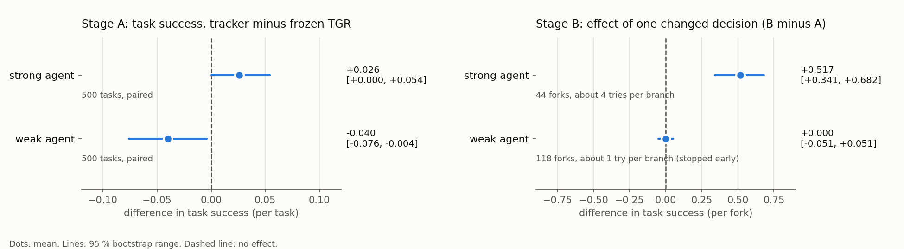
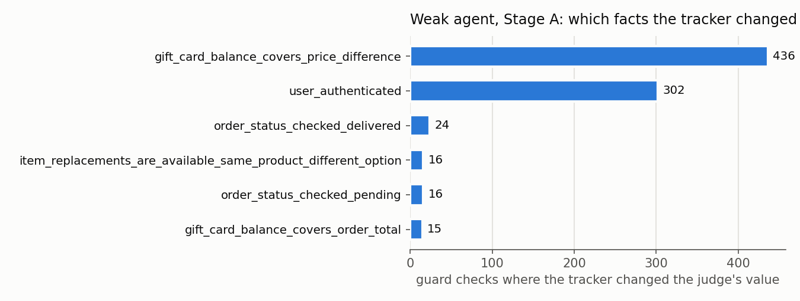

# Tracker Evaluation v2: Report (stopped early) and What to Change

Date: 2026-10-22. Plan: `docs/planning/tracker_eval_v2/`. Stopped by the user at 19:25 UTC, during Stage B, to
improve the method first.

## 1. Key numbers and verdict
| what | result |
|---|---|
| money spent | **$40.38** of the $100 limit (smoke test $0.16, Stage A $32.77, Stage B $7.45 before the stop) |
| Stage A, strong agent: task success, frozen TGR → TGR + tracker | 0.838 → 0.864: **+0.026** [0.000, +0.054] |
| Stage A, weak agent: task success, frozen TGR → TGR + tracker | 0.752 → 0.712: **−0.040** [−0.076, −0.004] |
| Stage A, GOOD task success (done **and** no rule broken), strong agent | **+0.024** [−0.002, +0.052] |
| Stage A, GOOD task success, weak agent | **−0.038** [−0.076, 0.000] |
| Stage A, τ-bench's expected actions (all done, no unwanted change): strong / weak | +0.020 [−0.008, +0.050] / −0.026 [−0.060, +0.008] |
| Stage B, strong agent: effect of one changed decision | **+0.52** [+0.34, +0.68] (44 decision points) |
| Stage B, weak agent: effect of one changed decision | **0.00** [−0.05, +0.05] (118 decision points, about 1 try each: too little data) |
| main cause found for the weak agent's drop | one design choice: "not shown yet" counted as **false** instead of **unknown** (gift-card balance, 428 guard checks) |

The numbers in brackets are 95 % ranges. If a range does not include 0, the difference is very unlikely to be chance.

**Verdict: not a success yet. The core idea works, but one design choice cancels the gain for the weak agent.**
- **Strong agent:** when the tracker changes a decision, the task gets done far more often (+0.52 per changed
  decision). Overall success rises by +0.026, at the edge of chance.
- **Weak agent:** success falls by −0.040, and this is not chance. The fall does not come from the decisions the
  tracker changes, which have about zero effect on average. It comes mostly from the guard's *message* to the agent,
  which got harsher because of the design choice above (section 4).
- **GOOD task success tells the same story.** Done *and* no rule broken (by the gold scorer): strong +0.024, weak
  −0.038. τ-bench's own expected actions agree in direction. Rule breaks that went through are few on both sides
  (strong 2 vs 0, weak 13 vs 20). These numbers come from agent G1, just before the stop, and were not re-checked
  (`predicate_correctness/output/eval_v2/good_success_stage_a.md`).
- **Not measured yet**, because the run was stopped: the effect by conversation length, and the rest of Stage B.

## 2. The words used here
| word | meaning |
|---|---|
| τ-bench | a test set of customer-service conversations (here: retail). An LLM plays the customer; another LLM is the agent. |
| task success | τ-bench's own check at the end: is the database in the expected state? From 0 to 1. |
| guard | a checker that sees every action of the agent before it runs, and allows or blocks it. |
| TGR, frozen TGR | my partner's guard, in its fixed version. It has rules over yes/no **facts** ("predicates"), e.g. "the user logged in". |
| judge | the LLM that TGR asks, at every action, for the value of every fact. It reads only the last 24,000 characters. |
| tracker | our addition: it sets 31 of the 66 facts with code, from a copy of the database and the tool calls, instead of the judge. |
| strong / weak agent | the agent LLM: gpt-6-luna (strong) or gpt-5-nano (weak, breaks the rules more often). |
| Stage A | 500 new τ-bench tasks, each run once with frozen TGR and once with TGR + tracker, then compared task by task. |
| Stage B | at each point where the two guards decide differently, the same conversation is continued both ways (A = frozen TGR's decision, B = the tracker's), 5 times each. Both ways share everything before that point, so the difference is the effect of that one decision. |
| gold scorer | my partner's hand-written rule checker, used only to score. No one has checked that it is right. |

## 3. What we did, and what happened
1. **Built and checked everything without money** (Parts 1-4): the code for both stages, 3 independent reference
   builders, and 5 independent auditors.
   - They found 1 serious bug and 1 unfairness, and both were fixed before any money was spent:
     - the bug: a thread race made 6-10 % of the tracker's checks fall back to the judge in a test with fake LLMs;
     - the unfairness: in Stage B, an exact repeat of a blocked action was asked to the judge again, while in a
       real run the judge's saved answer is reused.
   - 288 tests pass.
2. **Smoke test** ($0.16): everything ran end to end.
3. **Stage A** (2,000 conversations, $32.77): every conversation finished. One failed unit (Azure's content filter
   refused a judge prompt) was run again and passed. The tracker's lookups had 0 errors in 13,348 guard checks.
4. **Fork points** (no money): 175 points where the two guards decide differently.
   - 55 come from saved runs and 120 from Stage A.
   - They make up 3 % of the strong agent's conversations and 9 % of the weak agent's.
   - All 175 were rebuilt exactly, and every one passed the checks.
5. **Stage B**: 619 of 1,750 tries were done when the user stopped it. The strong agent's points are nearly complete
   (about 4 of 5 tries per side). The weak agent's have about 1 try per side.

**Where the tracker changed a decision** (Stage A, tracker side):
- **Strong agent:** 14 of 500 tasks, 29 decisions, all wrong-looking blocks removed (mostly a missed login: the login
  had fallen out of the judge's 24,000-character view). In 11 of these 14 tasks only the tracker side succeeded; in
  none did only frozen TGR succeed.
- **Weak agent:** 49 of 500 tasks, 241 decisions. 219 were blocks removed (almost all a missed login) and 22 were
  blocks added (mostly an order status that had changed). Here the outcome is a tie: 13 tasks done on each side.

**Do Stage A and Stage B agree?** Effect per changed decision × how often decisions change ≈ the overall effect.
- **Strong agent:** +0.52 × 3 % ≈ +0.015. That lies inside Stage A's range [0.000, +0.054], so the two agree.
- **Weak agent:** about 0 × 9 % ≈ 0. Stage A shows −0.040, so the two do **not** agree. Something other than the
  changed decisions lowers the weak agent's success.

## 4. Why the weak agent did worse

The fact the tracker changed most often was not the login. It was `gift_card_balance_covers_price_difference`, which
decides TGR's rule 56: "a gift card used to pay a price difference must have enough balance".
- **How the fact is worded.** TGR's own LLM rule-writer worded it as "*earlier tool output establishes* that the
  gift card … has enough balance". So the question it asks is "did a tool output already show it?", not "is the
  balance enough?".
- **The choice we made.** We followed that wording literally: the tracker uses only what tool outputs showed, and
  if the card was never shown it answers **false** (`state_tracker/lookups_retail.json`). The database had the true
  balance, but the tracker did not use it.
- **Why this case is so common here.** In the 500 new tasks, the customer gives the gift-card id at the start, so the
  agent often never looks the card up.
- **What changes in the guard.** The judge said "not established" (unknown) in 428 such checks with the weak agent;
  the tracker said false. Both block the action, but TGR's message to the agent differs:

  | judge's value | TGR's message to the agent |
  |---|---|
  | unknown | "this has not been checked: look it up with a read-only tool, then try again" |
  | false | "rule 56 is violated: do not repeat the same call, offer an allowed alternative" |

- **What the weak agent does next.** At blocks where the tracker turned the judge's "unknown" into "false", its next
  step was a lookup in 63 of 283 cases (22 %) after frozen TGR's "look it up", and in only 31 of 382 (8 %) after the
  tracker's "violated" (agent G1). An earlier, smaller count gave the same direction (24 of 67 vs 14 of 97). It also
  handed over to a human more often: 89 hand-overs with the tracker against 66 without.

This explanation fits the numbers, but it is **not proven**. The cases are picked from the tracker's own
conversations, so it is not a fair split.

**A second, smaller effect.** For the weak agent, removing a wrong block did not help on average (Stage B: 0.00). A
weak agent that is no longer blocked can also make a mistake that the wrong block had stopped by luck.

## 5. What is objective here, and what is not
- **Objective:** the database values. The tracker re-runs τ-bench's own tool code, and it reproduced every tool output
  exactly (7,168 of 7,168). τ-bench's task success is also objective, but it does not check the policy rules.
- **Not objective:** whether a guard decision is "right". That depends on how the policy is read. The judge, the gold
  scorer and our reviewer agent are three readings, and none of them was checked by a person. The gold scorer also
  reads the same database facts as the tracker, so their agreement shows consistency, not truth.
- **A label from the benchmark itself:** τ-bench lists the expected actions of each task. Counted as "every expected
  action done and no unwanted change", it agrees in direction with task success: strong +0.020, weak −0.026, both
  within chance (section 1).

## 6. How to keep this from happening again
1. **Three answers, not two.** Every fact can be true, false, or **not known yet**. "Not shown yet" must be "not
   known yet", so the guard says "check first" and not "forbidden".
2. **Use the database when the rule is about the world.** "Is the balance enough?" has a true answer in the database.
   Use "what was shown" only when the rule is about what the agent did ("the agent checked the status"), and then
   "not checked" means "check first".
3. **Test the guard's message, not only its decision, before paying.** The offline test compared decisions only. A
   count of "same decision, different message" on the saved runs would have shown this case before Stage A.
4. **Judge the method by good task success and τ-bench's expected actions**, not by task success alone.
5. **Try the weak agent offline first.** It reacts most to the guard's messages.
6. **Have a person check the few reading choices that decide many cases.** This one changed 436 guard checks with the
   weak agent.

## 7. Back to the drawing board: what to change in the method
1. **Fix the two reading choices above** (three answers; database facts for world facts). Test offline first, for
   $0, by re-deciding the saved conversations, and count the decisions *and* the messages that change.
2. **Better messages from known facts.** When the tracker knows the fact, the guard can say it exactly, for example
   "the gift card balance is $17; the price difference is $32". That tells the agent how to fix the problem.
3. **Reduce, and where possible remove, the facts that only the LLM judge sets from meaning** (the user's request).
   Today these are 35 of the 66 facts: 67 % of the judge's values, and 71 % of the values behind blocks. The
   "reminded the user" facts alone decide 44 % of the blocked checks. A step-by-step path, each step tested offline
   first (details in `docs/planning/tracker_eval_v2/idea_track_more_facts.md`):
   - **a. Code from the messages' structure.** Did the user type this email? Does the agent's last message list
     every argument of the action? Is the user's next message a reply to that list? Cost $0. Estimated to remove
     about 15 % of the blocks.
   - **b. One tiny, checkable question per message**, where meaning is really needed: "is this a yes?", "is this a
     reminder to list all items?". The answer is saved and reused, and it is never cut by a view limit.
   - **c. Remove meaning altogether, by design:** let confirmations be events with a fixed shape, for example the
     agent calls a `confirm(action, arguments)` step and the user answers yes or no. Then the guard reads an event
     instead of judging meaning. This changes how the agent works, so it is a new variant to test.
   - **d. Keep the judge only for what cannot be fixed this way**, such as "this request cannot be handled; hand it
     to a human". That kind decides few blocks (32 of 537 in the saved runs).
   - **Safety rule for all of these:** a new "allow" needs two keys (code and the tiny question agree), so a wrong
     "yes" stays unlikely.
4. **Not a bigger view of the conversation.** Any fixed view cuts something in a long conversation. The tracker's
   state does not depend on length, which is its general advantage. The planned split by conversation length (Part
   9) tests this directly.
5. **Stage B also at "same decision, different message" points**, so the message effect is measured directly.

## 8. Limits
- Stage B was stopped at 35 % of its tries. The weak agent's Stage B result rests on about 1 try per side.
- The 500 new tasks are easier and follow one template: the ids are given and only write actions are expected. So
  task success is not comparable with earlier reports, but the comparison between the two guards on the same tasks
  is fair.
- One task try per guard in Stage A. The range is about ±0.035.
- No person has checked the reading choices, the gold scorer or the reviews.

## 9. Files, and how to recompute
- **Numbers:** `predicate_correctness/scoring/v2_report_numbers.py` → `predicate_correctness/output/logs/v2_report_numbers.json`.
  It uses the standard library only, no LLM and no gold code.
- **Figures:** `predicate_correctness/scoring/v2_report_figures.py` → `docs/reports/figures/`.
- **Run reports** (index: `predicate_correctness/output/eval_v2/README.md`):
  - `predicate_correctness/output/eval_v2/stage_a_runs.md` (Stage A);
  - `good_success_stage_a.md` (GOOD task success and τ-bench's expected actions; script `scoring/v2_good_success.py`);
  - `fork_points.md` (fork points);
  - `checks/` (Part 1, the audit, the smoke test).
- **Data:**
  - `predicate_correctness/output/eval_v2/stage_a/<agent>/<guard>/episodes*.jsonl`;
  - `stage_b/<fork id>/<branch>/<try>.json`;
  - `fork_points.jsonl`.
- **Cost log:** `docs/planning/tracker_eval_v2/approval_request.md`.
